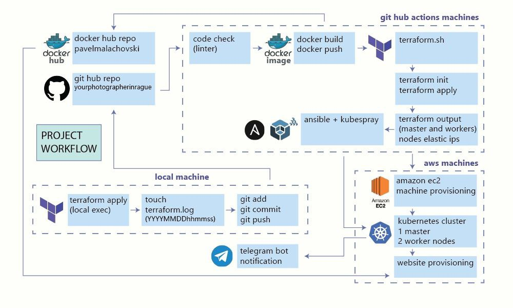

# YourPhotographerInPrague


Infrastructure-as-code for a WordPress photography site: AWS (Terraform) → 3-node
Kubernetes cluster (kubespray) → containerised WordPress + MySQL, delivered by GitHub Actions.



## Stack
- **Terraform**: EC2 (encrypted EBS, IMDSv2), Elastic IPs, least-privilege security group,
  S3 remote state with native locking; bootstrap stack for state bucket + GitHub OIDC roles
- **kubespray** `v2.26.0` on Ubuntu 22.04
- **Docker / Compose**: WordPress 6 (PHP 8.3), MySQL 8.4, phpMyAdmin (on demand, localhost only)
- **GitHub Actions**: OIDC to AWS (no static keys), SHA-pinned actions, Gitleaks + Checkov
  security gates, `terraform fmt/validate/plan` on branches, gated `apply` on `master`

## Security
See [docs/SECURITY_AUDIT.md](docs/SECURITY_AUDIT.md) for the full audit: 3 critical and 6 high findings, all fixed.

## Local development
```bash
cp .env.example .env        # set strong passwords
docker compose up -d        # http://127.0.0.1:8888
docker compose --profile tools up -d   # + phpMyAdmin on http://127.0.0.1:3001
```

## Deploy (AWS)
Prerequisites: [Terraform ≥ 1.10](https://developer.hashicorp.com/terraform/install), an AWS account.

```bash
# one-time
cd terraform/bootstrap && terraform init && terraform apply -var state_bucket_name=<unique-name>

# cluster
cd ../YPIP/development
cp backend.hcl.example backend.hcl   # set bucket
terraform init -backend-config=backend.hcl
TF_VAR_admin_cidr_blocks='["<your-ip>/32"]' terraform apply
```
In CI, the same steps run in `.github/workflows/master.yml`. See the setup checklist in the audit doc.

### How to migrate the WordPress website
[](https://www.youtube.com/watch?v=kpsjTPsygbs)
